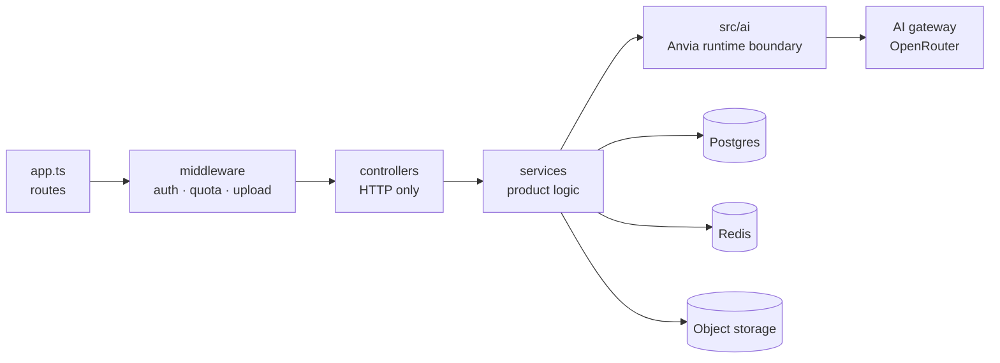

<p align="center">
  
</p>

<h1 align="center">stiker-api</h1>

<p align="center">
  The backend for <a href="https://github.com/iqbalShafiq/setiker">Setiker</a>, the neubrutal WhatsApp sticker maker.
</p>

<p align="center">
  <a href="LICENSE"></a>
  
  
  
  
  
</p>

Accounts, cloud sync, the public pack feed, AI generation and background removal, and store billing
for one app. It is a single Express service: thin routes, controllers that only translate HTTP,
services that own the product behaviour, and every AI call confined to one directory.

## Quick start

You need **Node.js 20+** and **Docker**.

```bash
git clone https://github.com/iqbalShafiq/stiker-api.git
cd stiker-api

cp .env.example .env          # JWT secrets, DATABASE_URL, AGENT_API_KEY
docker compose --profile dev up -d postgres redis
npx prisma migrate deploy
npx prisma db seed            # roles, billing products, AI model catalog
npm run dev
```

The API listens on `:7845`. `GET /health` returns the readiness of Postgres, Redis and the model
catalog, and `GET /docs` opens the Scalar API reference.

| | |
| --- | --- |
| API | http://localhost:7845 |
| Health | http://localhost:7845/health |
| API reference | http://localhost:7845/docs |
| OpenAPI 3.1 | http://localhost:7845/openapi.json |

One compose file drives every environment through profiles: `dev`, `test` (Postgres on `5433`, Redis
on `6380`) and `prod` (the published image behind nginx on `8080`/`8443`).

## The API

| Group | What it covers |
| --- | --- |
| `/api/v1/auth` | Email and password, Google, Apple, sessions, password reset |
| `/api/v1/users` | Profiles, public profiles, search, blocking |
| `/api/v1/sticker-packs` | Packs, stickers inside them, reordering, visibility, sharing |
| `/api/v1/stickers` | Sticker CRUD, sharing, share links |
| `/api/v1/sync` | The pull and push reconciliation the app runs on launch |
| `/api/v1/ai` | The daily quota, and the AI usage snapshot |
| `/api/v1/billing` | Products, purchase verification, subscriptions, restore |
| `/api/v1/share` | Public share previews |
| `/api/v1/notifications` | Likes, follows and imports |
| `/api/v1/legal` | The legal documents the app links to |
| `/api/v1/processing-history` | Failed and finished background work |
| `/api/v1/prompt-presets` | The AI prompt presets the app offers |
| `/api/v1/featured/today` | The pack the Explore tab features |
| `/api/v1/admin` | Moderation and content review |

## Configuration

Copy `.env.example` and fill in the keys for the parts you want running. The database URLs already
match the compose file.

| Variable | What it unlocks |
| --- | --- |
| `DATABASE_URL`, `REDIS_URL` | Postgres and Redis. Required at boot. |
| `JWT_SECRET`, `JWT_REFRESH_SECRET` | Signed sessions. Required at boot, no placeholder defaults. |
| `AGENT_API_KEY`, `AGENT_BASE_URL` | The AI gateway. `AGENT_BASE_URL` is OpenAI-compatible and defaults to OpenRouter. |
| `LANGFUSE_PUBLIC_KEY`, `LANGFUSE_SECRET_KEY` | Traces for each agent run. |
| `GOOGLE_CLIENT_IDS`, `APPLE_CLIENT_IDS` | Accepted sign-in audiences. |
| `RESEND_API_KEY`, `RESEND_FROM` | Password reset and set-password email. |
| `IMGLY_BG_MODEL` | The background removal model size. |
| `GOOGLE_PLAY_MOCK_MODE`, `APPLE_MOCK_MODE` | Mock store verifiers for local work. |
| `XENDIT_ENABLED` | Optional checkout for builds that are not in a store. |

The full list, with defaults, is in [`.env.example`](.env.example).

## Architecture



| Directory | Responsibility |
| --- | --- |
| `src/ai/` | The only place that imports `@anvia/*` at runtime. The packages are ESM-only, so they load through the `src/ai/esm.ts` seam. |
| `src/controllers/` | HTTP translation only. No product logic. |
| `src/services/` | The product behaviour: stickers, packs, billing, grid split, image and vision AI. |
| `src/ai/provider/` | The gateway boundary: the client, the completion model, and the Images API adapter. |
| `prisma/` | The schema, the base seed, and the AI model catalog. |

Model selection is **data, not environment**: the `AiModel` table has one row per role, so a model
can be changed with an `UPDATE` and a restart, without a deploy.

The full picture, including the ESM seam and the provider boundary, is in
[docs/ARCHITECTURE.md](docs/ARCHITECTURE.md).

## Quality gates

```bash
npm run lint          # eslint
npm run typecheck     # tsc --noEmit
npm test              # vitest, 415 tests
npm run build && npm run check:dist
```

`check:dist` verifies that the compiled build can actually load the ESM-only `@anvia/*` packages
through the shim.

The suite needs its own database:

```bash
npm run test:up        # postgres-test and redis-test
npm run test:migrate   # migrate AND seed the test database
npm test
npm run test:down
```

`test:migrate` applies the migrations and seeds the test database (roles, billing products, the AI
model catalog), which the suite requires. Give the test stack exclusive use: concurrent runs, or an
external `test:down -v`, produce phantom failures.

CI runs the same gates on every pull request, and builds and publishes the image on `master`.

## Reference

| Document | What is in it |
| --- | --- |
| [docs/AUTH.md](docs/AUTH.md) | Google, Apple and password: the setup checklists, the endpoints, and the continuity rules. |
| [docs/AI.md](docs/AI.md) | The daily quota, the gateway, the model catalog and the tracing. |
| [docs/BILLING.md](docs/BILLING.md) | Store compliance, the purchase endpoints and how the AI quota is charged. |
| [docs/ARCHITECTURE.md](docs/ARCHITECTURE.md) | The layers, the AI runtime boundary and the model catalog. |
| [docs/DEPLOYMENT.md](docs/DEPLOYMENT.md) | Production setup, TLS and the deployment scripts. |

## Contributing

Issues and pull requests are welcome. Open a branch from `master`, keep the change focused, and say
what you ran.

## License

stiker-api is open source under the [MIT License](LICENSE).
